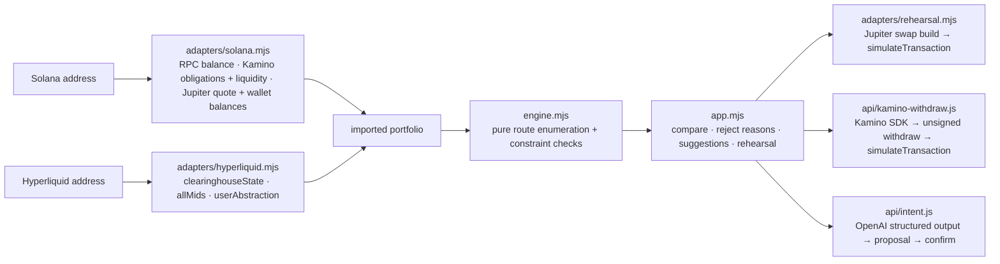

# ExitPlan — the pre-flight check for unwinding a Solana–Hyperliquid hedge

**Live:** https://exitplan-rouge.vercel.app · **Hackathon:** Crypto World's Fair 2026 (Solana and Hyperliquid tracks) · **License:** MIT

ExitPlan is the pre-flight check for raising cash from a Solana–Hyperliquid hedge: it finds the routes that keep your exposure, margin and debt rules, explains the routes that fail, and simulates the Solana transactions before you sign.

Phantom put Hyperliquid perps one tap away from Solana spot, so a common position now spans two chains: SOL and USDC (often in Kamino) on Solana, and a Hyperliquid short that hedges it and earns funding. When you need cash, every lever breaks something: sell SOL and you are net short; pull margin and your liquidation price drops; withdraw from Kamino and you depend on a pool that is 93% lent out. No app sees both sides, so people unwind by feel and learn what broke after they sign.

You give ExitPlan a **cash goal plus the limits you refuse to break** (new-debt cap, keep net SOL exposure, keep-SOL-quantity, minimum margin buffer). It reads both chains by address, evaluates dozens of routes, shows every route that fits and every route that does not, with the reason, and rehearses the chosen route with real `simulateTransaction` runs for the Solana legs. Nothing is signed or sent. Standard and Unified Hyperliquid accounts are supported; portfolio margin is not modelled.

## What is real in this build

- **Real positions by address, Phantom connect, or a deep link.** Enter a Solana wallet and a Hyperliquid address, press *Connect wallet (read-only)* (Phantom, OKX or any injected wallet: it reads the Solana address and the EVM address used on Hyperliquid, never signs), open a `#sol=…&hl=…&target=…` link, or press *Load public example*. The browser reads them read-only from public APIs: SOL balance (publicnode RPC), Kamino main-market USDC deposits and borrows (Kamino API), the SOL short, equity, withdrawable and other positions on Hyperliquid (public info API), the HyperCore account mode (`userAbstraction`), USDC already sitting in the wallet (Jupiter balances, used first at zero fee), and a live Jupiter quote for SOL → USDC.
- **Real transaction simulation, two legs.** In the rehearsal, the Solana sell leg builds an unsigned Jupiter swap for the entered wallet and runs Solana `simulateTransaction` (signature verification off, fresh blockhash). The Kamino withdrawal leg builds the real unsigned withdraw transaction with Kamino's SDK in a server function (create ATA if needed, refresh reserve, refresh obligation, withdraw and redeem), simulates it the same way, and reads the wallet's USDC token account from the simulation to report **what would actually arrive** against the plan. You see success or the exact program error, compute units and the instruction list. Nothing is ever sent.
- **Fees from your account and a read-only fill preview on Hyperliquid.** The short-reduction fee is your own taker rate from the public `userFees` endpoint (rounded up to the basis point) instead of a fixture, and in the rehearsal the reduce-short step walks the live SOL order book to show the average buy-back price, slippage in basis points, levels used and the estimated fee. It also shows the exact unsigned reduce-only IOC order the user would sign (asset index, lot-sized size, tick-rounded limit with a 0.5% cap), the buy-back cost against the plan's mark and the book's age. No order is placed; the withdrawal step still needs a signed request and stays unsimulated.
- **Margin math that matches the exchange.** For a live four-position account the model's withdrawable equals Hyperliquid's reported withdrawable to the cent, and the mark comes from the position's own value; the liquidation estimate is anchored on the exchange's number.
- **Deterministic route engine** that enumerates withdrawals, sales, paired unwinds, short-only reductions with released margin, and borrowing comparisons, with integer-cent arithmetic, fail-closed validation and 228 automated tests, including a 650-plan conservation grid.
- **AI intent with confirmation.** Describe the goal in your own words; a server function turns it into a constraint proposal (OpenAI structured output, validated against a schema), and nothing applies until you confirm.
- **Pre-flight readout.** After an import, a checklist grades what matters before any unwind: account mode verified, net exposure (flagged when not neutral), liquidation distance, HL margin buffer against your floor, Kamino reserve liquidity against your deposit, wallet USDC, other positions, and what is not simulated.
- **Carry given up per route.** Every route shows the yearly carry it gives up at today's rates: funding on the SOL short reduced (7-day average from Hyperliquid's funding history) plus supply yield on the Kamino deposit withdrawn (reserve supply APY). Routes are still ranked by upfront fees; the carry figure is there to change the decision, not the sort.
- **Copy-able pre-flight report.** One button turns the checks, every route with its fees and carry, the rejected routes with reasons and the deep link into a plain-text report to paste into a chat or a ticket.
- **Placeable quantities.** Short reductions are sized in Hyperliquid's SOL lot (0.01 SOL, read from `meta`) and reductions below the $10 minimum order are rejected with the reason, so every route is one the exchange would accept.
- **Liquidation price before and after.** The exchange's own liquidation price is shown at load, and after a route an estimate anchored on that price (maintenance margin = 1 / (2 × max leverage)) shows where it would move. It is labelled an estimate.
- **Kamino withdraw capacity capped by reserve liquidity** read from Kamino's reserve metrics at load.
- **Public Hyperliquid market reference** (SOL perp mid) shown next to the planning price, never silently substituted.

## What is not real (yet)

- No execution. No signing, sending, bridging, borrowing or trading; the wallet button only reads addresses.
- Hyperliquid legs are not simulated (they need signed exchange requests); the reduce-short step gets a read-only order-book preview, the withdrawal step is listed only.
- Fees other than the Jupiter-quoted sale and your Hyperliquid taker rate, the margin reserve rule, durations and borrowing terms are model assumptions and are labelled as such in the app.
- **Standard and Unified Hyperliquid accounts.** The account mode is verified on HyperCore. For a Unified account the spot USDC total is the equity (it already contains the perps margin and unrealised PnL) and withdrawable is total minus hold, both exchange figures; the model cross-checks them against the exchange's available-after-maintenance figure and flags a mismatch (positions on other perp DEXs are not modelled). Other stable collateral (USDH, USDT0, USDE) and SOL held on HyperCore spot are reported but not modelled. Portfolio-margin accounts pool several collateral assets and are rejected with that explanation. Vault addresses (for example HLP) are rejected as not being user accounts. Every position reserves the larger of its initial margin and 10% of its notional, the exchange's transfer rule, which makes the model's free collateral match the exchange's reported withdrawable on real accounts; for the SOL short that rate is also what a route releases when it reduces the position.
- Only Kamino obligations that hold USDC alone are supported; mixed-asset obligations and any existing borrow are rejected with a reason.
- The margin reserve is max(10% of notional, the position's initial margin), Hyperliquid's transfer rule, not its maintenance margin. The after-route liquidation price is a model estimate for the SOL position alone, anchored on the exchange's number, with other positions held constant.
- Carry is an estimate at today's rates (7-day average funding, current supply APY), shown per route and not used for ranking; funding changes hourly and the deposit yield changes with utilisation.
- The minimum margin buffer only blocks routes that lower the Hyperliquid buffer; an account that already sits under the floor can still raise cash on Solana. On import, a floor above the current buffer is lowered to half the buffer and the app says so.
- Ranking means lowest upfront fees among a bounded set of evaluated candidates (dozens, not all), not a global optimum or financial advice.

## Try it

1. Open the live site. The default is a synthetic scenario (100 SOL, 3,000 USDC deposited, 100 SOL short). Walk the three guided scenarios.
2. Switch **Portfolio source** to *Import by address*, paste a Solana wallet and a Hyperliquid address (public examples in `docs/demo-addresses.md`) and load.
3. Set a target, compare routes, open a rejected route to read why. If nothing fits, the banner offers concrete relaxations that do ("Allow selling SOL (keep net exposure) → $5,000 route"). Select a route and open the rehearsal. On the sell step, press *Simulate on Solana (read-only)*. *Copy plan link* gives a shareable deep link.

## Run locally

Requires Node.js 20+. The browser app has no dependencies; the Kamino simulation function uses `@kamino-finance/klend-sdk` and `@solana/kit` on the server, and LinkeDOM powers the DOM tests.

```sh
npm ci --ignore-scripts
npm test                       # 228 tests: engine, adapters, server, UI
npx vercel dev                 # serves web/ and the api/ functions
```

AI needs two server-side environment variables, never in the browser: `OPENAI_API_KEY` and `OPENAI_MODEL`. Without them the AI panel says it is offline and everything else works. The Kamino simulation uses the public Solana RPC by default; set `SOLANA_RPC_URL` to use your own. `package.json` pins `uuid@9` under `rpc-websockets` (an `@solana/web3.js` 1.x dependency of the SDK) because the serverless runtime cannot `require()` the ESM-only `uuid@14`.

## Use it from the terminal

The same adapters, engine and report run in Node without the UI, so the pre-flight can sit in a script, a bot or a CI job:

```sh
node bin/exitplan.mjs --sol <solana wallet> --hl <0x address> --target 500          # plain-text report
node bin/exitplan.mjs --sol … --hl … --target 500 --keep-sol --json               # engine result as JSON
```

Flags: `--max-debt`, `--min-buffer`, `--deadline`, `--keep-sol`, `--no-hedge`, `--select <route id>`. It reads the same public endpoints and never signs or sends.

## Use the engine as a library

`web/engine.mjs` is a dependency-free ES module (Node 20+ or any browser) with no I/O: give it a portfolio and constraints, get every evaluated route back with the reasons it was accepted or rejected.

```js
import { createDemoPortfolio, defaultConstraints, planExit } from './web/engine.mjs';

const result = planExit(createDemoPortfolio(), { ...defaultConstraints(), target: 5000, preserveHedge: false });
console.log(result.best.id, result.best.netCash, `${result.feasible.length} of ${result.plans.length} routes fit`);
for (const plan of result.plans.filter(p => !p.feasible)) console.log(plan.id, plan.rejections);
```

The portfolio shape is documented in `docs/engine.md`; the adapters in `web/adapters/` show how to build one from public APIs.

## Architecture




```
browser (web/)                                     Vercel functions (api/)
  engine.mjs        pure route enumeration           status.js   capability flags
  adapters/         read-only public API clients     market.js   Hyperliquid SOL mid
    hyperliquid.mjs info API → engine shape          intent.js   OpenAI structured output
    solana.mjs      RPC + Kamino + Jupiter → shape    server/     shared handlers + tests
    rehearsal.mjs   Jupiter swap → simulateTransaction; Kamino withdraw via api/
                                                       kamino-withdraw.js  Kamino SDK → unsigned withdraw → simulateTransaction
  app.mjs           constraints, comparison, rehearsal, AI confirmation
```

Every adapter fails closed with a reason code; the UI never substitutes cached or scenario numbers when a load fails. The engine accepts `evidence: 'scenario'` or `'imported'` and carries that label onto every plan card.

## Disclosure

All commits are dated 2026-10-11 and 2026-10-12 (UTC+4), inside the hackathon window, by a solo builder working with AI coding assistants. The synthetic engine and UI were generated that morning with OpenAI's app tooling and imported as the first commit, which is why the history starts from a complete snapshot; the real-data adapters, Vercel deployment, English copy and independent reviews (Claude, Codex and Claude Opus, several rounds) followed over the two days. No code predates the window. Public addresses listed in `docs/demo-addresses.md` belong to other people; they are read-only examples and are not ours.

## Documents

- `docs/engine.md` — route engine contract and verified examples
- `docs/integrations.md` — API boundaries and what each adapter does and does not claim
- `docs/demo-addresses.md` — public example addresses
- `docs/pitch-video-script.md`, `docs/demo-video-script.md`, `docs/submission-copy.md`
- `docs/superpowers/specs/` and `docs/superpowers/plans/` — design spec and implementation plan

This is a planning prototype, not investment, lending or tax advice, and not an assurance that any real exit is safe or available.
