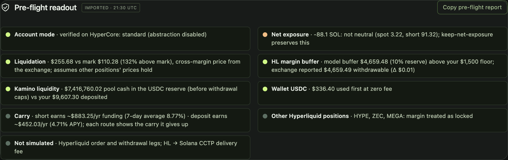
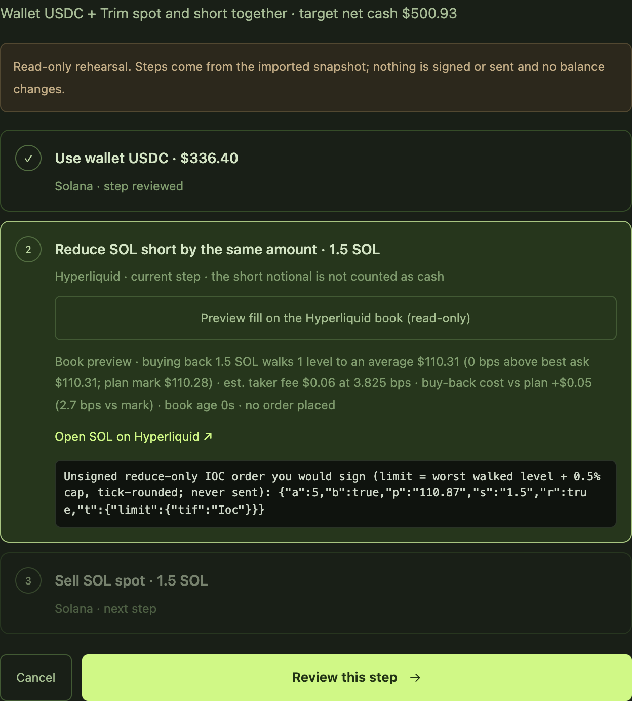
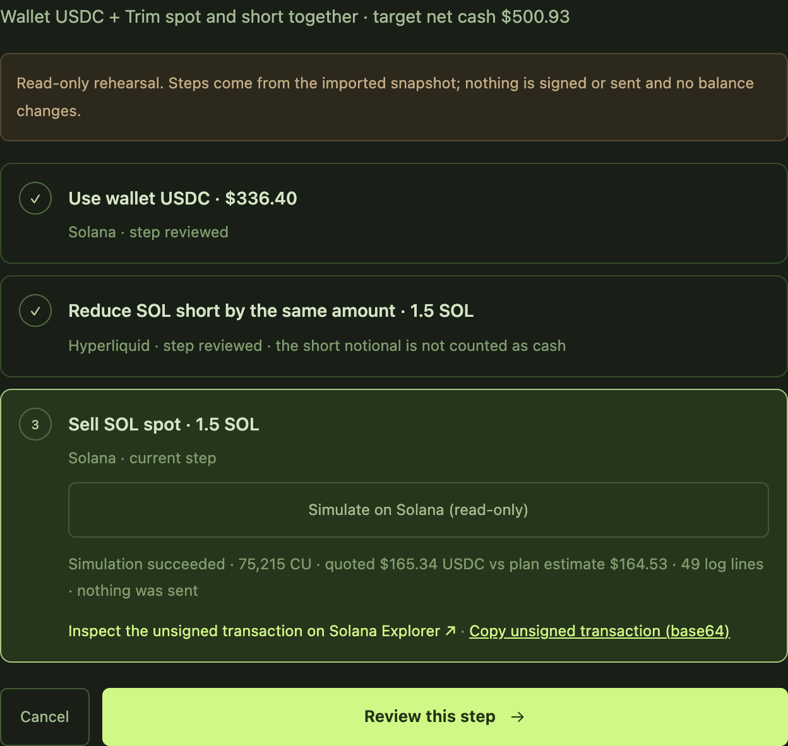
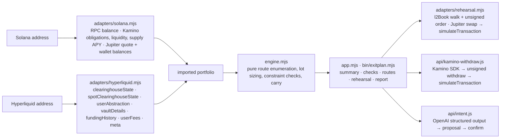

# ExitPlan — the pre-flight check before you unwind a Solana–Hyperliquid hedge

**Live:** https://exitplan-rouge.vercel.app · **Hackathon:** Colosseum Crypto World's Fair 2026, Solana and Hyperliquid tracks · **License:** MIT · **Tests:** 296 (`npm test`) [](https://github.com/plutohan/exitplan/actions/workflows/test.yml)

Give ExitPlan two addresses (a Solana wallet, a Hyperliquid account), a cash goal and the limits you refuse to break. It reads both chains, evaluates a bounded set of unwind routes against your exposure, margin and debt rules, explains every route that fails, prices each one with your own fees and the carry it gives up, and rehearses the legs before you sign: the Solana transactions through real `simulateTransaction` runs, the Hyperliquid order built on the live book. **Nothing is ever signed or sent.**



## Why this exists

Phantom put Hyperliquid perps one tap away from Solana spot, so a common position now spans two chains: SOL and USDC (often in Kamino) on Solana, and a Hyperliquid short that hedges it and earns funding (about 8–9% a year over the last week). When you need cash, every lever breaks something: sell SOL and you are net short; pull margin and your liquidation price drops; withdraw from Kamino and you depend on a pool that is 93% lent out. No app sees both sides, so people unwind by feel and learn what broke after they sign.

## Try it in three clicks

1. Open https://exitplan-rouge.vercel.app and press **Try on live accounts (read-only)**. It probes a short list of public Hyperliquid accounts, loads the first that still holds a SOL short next to a public Kamino wallet, lands on a $500 goal and selects the paired trim route. (Or paste your own addresses, or open a deep link such as `#sol=…&hl=…&target=500`.)
2. Read the summary strip and the pre-flight line ("5 ok · 1 warning"); press **Show checks** for the reasons. Change the goal or the rules and watch routes pass or fail, each with a sentence that says why.
3. Press **Step-by-step rehearsal**. The Hyperliquid step walks the live order book and shows the unsigned reduce-only order you would sign; the Kamino and Jupiter steps run real Solana simulations and link each unsigned transaction to Solana Explorer's inspector.

<p align="center"> </p>

## What is real, and how you can check it

| Claim | How it is verified | Where to look |
| --- | --- | --- |
| Positions are read by address from public APIs only | Solana RPC, Kamino API, Jupiter, Hyperliquid info API; the request log in Chrome shows nothing else | `web/adapters/`, `docs/integrations.md` |
| The Hyperliquid account mode is verified | `userAbstraction` on HyperCore: Standard and Unified import, portfolio margin and vaults are rejected with the reason; a `default` setting is established from the balances and always warned | `web/adapters/hyperliquid.mjs` |
| Margin math matches the exchange | Every position reserves max(initial margin, 10% of notional), Hyperliquid's transfer rule; on live accounts the model's withdrawable matched the exchange's: $5,444.93 against $5,444.94 on a Standard account and $15,436.60 to the cent on a Unified account (2026-10-12); any gap from resting orders is shown as such | pre-flight check "HL margin buffer", `docs/verification.md` |
| Routes are placeable | Short reductions sized in the 0.01 SOL lot from `meta`, checked against the $10 minimum, priced at your own `userFees` taker rate plus a 10 bps execution allowance | route cards, `docs/engine.md` |
| The Hyperliquid leg is built, not imagined | `l2Book` walk: average buy-back price, slippage, levels, book age, cost against the plan, and the inner unsigned reduce-only IOC order (asset index, size, tick-rounded limit capped at the allowance); withheld when the book is stale | rehearsal, step "Reduce SOL short" |
| The Solana legs really simulate | Kamino's SDK builds the real withdrawal, Jupiter builds the real swap; both run through `simulateTransaction` and report compute units, the Kamino leg the USDC the simulation delivers and the Jupiter leg its quoted output against the plan; each has a Solana Explorer inspector link and a copy of the unsigned transaction | rehearsal, steps "Withdraw deposited USDC" and "Sell SOL spot" |
| Carry is visible | Each route shows the yearly carry it gives up: 7-day average funding on the short reduced plus Kamino supply APY on the deposit withdrawn (shown, not ranked) | route cards, pre-flight check "Carry" |
| The engine is deterministic and fail-closed | Integer-cent arithmetic, duplicate allocations collapsed, 296 tests including a 650-plan conservation grid and a lot-size property grid | `web/engine.mjs`, `tests/` |
| AI never acts on its own | Plain-English goal → schema-validated constraint proposal → applied only after you confirm | `api/intent.js`, `server/intent.mjs` |
| It composes | The same adapters, engine and report run from the terminal; the engine and report are dependency-free modules | `bin/exitplan.mjs`, `web/report.mjs` |

## What is not real (yet)

- No execution: no signing, sending, bridging, borrowing or trading. The wallet button reads addresses only.
- The Hyperliquid withdrawal leg is listed, not simulated (it needs a signed exchange request); the HL → Solana delivery fee is a $1 placeholder, not a CCTP quote.
- Positions on other perp DEXs (HIP-3) are not read; a cross-check flags unified accounts where that matters. Margin reserved by resting orders is not modelled; the readout shows the gap and routes use the exchange's withdrawable.
- Only Kamino obligations that hold USDC alone are supported; mixed collateral and existing borrows are rejected with a reason.
- Planning prices a SOL sale from a 1 SOL Jupiter quote plus a price-impact allowance; the rehearsal re-quotes the exact amount and shows the difference, so large sales can look better in the plan than in the rehearsal.
- Carry is an estimate at today's rates. Ranking means lowest upfront fees among a bounded set of candidates, not a global optimum or financial advice.

## Why it fits each track

**Hyperliquid.** The account is read through the public info API; its Standard or Unified mode is confirmed with `userAbstraction`; free collateral is computed with the exchange's own transfer rule and matched against its reported withdrawable; every reduction is lot-sized, fee-priced from `userFees` and checked against the $10 minimum; the rehearsal walks `l2Book` and shows the exact inner order a user would sign, and never sends it.

**Solana.** Positions come from Solana RPC, the Kamino API and Jupiter by address; the rehearsal builds the real Kamino withdrawal with the Kamino SDK and the real Jupiter swap, runs both through `simulateTransaction`, reports what would arrive against the plan and links each unsigned transaction to Solana Explorer's inspector.

## Verify it yourself in five minutes

```sh
git clone https://github.com/plutohan/exitplan && cd exitplan
npm ci --ignore-scripts
npm test                                                    # 296 tests, no network
node bin/exitplan.mjs --sol DrEDgXWTBfZbbVNT2ZdvxA5DUZx8CLTteGnsSJaXtZsK \
  --hl 0x31dea2516beee92135b96f464eeec3cf292a13f2 --target 500   # the same report as the site, read-only
```

Public example accounts (strangers to each other, read-only) and a test matrix of accepted and rejected cases are in `docs/demo-addresses.md`; `docs/verification.md` records what was checked live and when.

## Run locally

Requires Node.js 20+. The browser app has no dependencies; the Kamino simulation function uses `@kamino-finance/klend-sdk` and `@solana/kit` on the server, and LinkeDOM powers the DOM tests.

```sh
npm ci --ignore-scripts
npx vercel dev                 # serves web/ and the api/ functions
```

Usage is counted with Vercel Web Analytics (cookieless page views plus three named events: `try-live`, `live-import`, `rehearsal-complete`); no address, amount or route is ever sent with them, and the app works the same when the analytics script is blocked.

Server-side environment variables, never in the browser: `OPENAI_API_KEY` and `OPENAI_MODEL` for the AI panel (without them it says it is offline and everything else works), and optional `SOLANA_RPC_URL` for the Kamino simulation (defaults to the public mainnet RPC). `package.json` pins `uuid@9` under `rpc-websockets` because the serverless runtime cannot `require()` the ESM-only `uuid@14`.

## Use the engine as a library

`web/engine.mjs` is a dependency-free ES module (Node 20+ or any browser) with no I/O: give it a portfolio and constraints, get every evaluated route back with the reasons it was accepted or rejected.

```js
import { createDemoPortfolio, defaultConstraints, planExit } from './web/engine.mjs';

const result = planExit(createDemoPortfolio(), { ...defaultConstraints(), target: 5000, preserveHedge: false });
console.log(result.best.id, result.best.netCash, `${result.feasible.length} of ${result.plans.length} routes fit`);
for (const plan of result.plans.filter(p => !p.feasible)) console.log(plan.id, plan.rejections);
```

The portfolio shape is documented in `docs/engine.md`; the adapters in `web/adapters/` show how to build one from public APIs, and `web/report.mjs` turns a result into the pre-flight checks and the plain-text report.

## Architecture



Every adapter fails closed with a reason code; the UI never substitutes cached or scenario numbers when a load fails. One retry covers a transient 429 or 5xx; a failed Jupiter swap quote falls back to Jupiter's price endpoint with a conservative fee and says so.

## Roadmap

1. One-click execution: Phantom signs the Solana legs, a Hyperliquid builder code routes the short, CCTP brings the USDC home; the pre-flight becomes the confirmation screen.
2. Watch tier: a standing pre-flight that alerts when a plan stops being feasible, carry flips or liquidation gets close.
3. Embeddable check for wallets and front-ends that already earn builder fees.
4. More venues behind the same engine: other Kamino markets, MarginFi and Jupiter Lend deposits, HIP-3 positions on Hyperliquid. Each is one adapter function; the engine and its tests do not change.

## Disclosure

All commits are dated 2026-10-11 and 2026-10-12 (UTC+4), inside the hackathon window, by a solo builder working with AI coding assistants. The synthetic engine and UI were generated on the morning of the 11th with OpenAI's app tooling and imported as the first commit, which is why the history starts from a complete snapshot; the real-data adapters, Vercel deployment, English copy and several rounds of AI-assisted code review (Claude, Codex and Claude Opus) followed over the two days. No code predates the window. Public addresses listed in `docs/demo-addresses.md` belong to other people; they are read-only examples and are not ours.

## Documents

- `docs/engine.md` — route engine contract and verified examples
- `docs/integrations.md` — API boundaries and what each adapter does and does not claim
- `docs/demo-addresses.md` — public example addresses and the test matrix
- `docs/verification.md` — what was checked live, and when
- `docs/launch-checklist.md`, `docs/pitch-video-script.md`, `docs/demo-video-script.md`, `docs/submission-copy.md`
- `docs/superpowers/specs/` and `docs/superpowers/plans/` — design spec and implementation plan

This is a planning prototype, not investment, lending or tax advice, and not an assurance that any real exit is safe or available.
